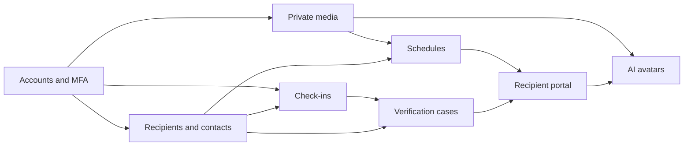

# 02 — Feature roadmap

Status: proposed, 2026-11-03. Priorities are for a small team shipping a trustworthy MVP before any avatar work.

## Priority legend

| Priority | Meaning |
| --- | --- |
| P0 | Required for a private beta that stores real family media |
| P1 | Required before death-related release is enabled for anyone outside the team |
| P2 | Required for a paid public MVP |
| P3 | Phase 2 or 3; do not build during the MVP |

## Phase 1 — Digital time capsule MVP

### A. Accounts and capsules

| ID | Feature | Priority | Notes |
| --- | --- | --- | --- |
| F-1.1 | Email registration, login, logout, session revocation | P0 | Password hashing with a memory-hard algorithm |
| F-1.2 | Email verification | P0 | No capsule sharing until verified |
| F-1.3 | Password reset that invalidates sessions | P0 | Reset must not release content |
| F-1.4 | Optional TOTP MFA and recovery codes | P0 | Strongly encouraged; mandatory for authors is decision D-4 |
| F-1.5 | Profile: name, locale, IANA time zone | P0 | Time zone required before any schedule is saved |
| F-1.6 | Create, rename, archive capsules | P0 | Multiple capsules per author |
| F-1.7 | Draft letters and structured metadata: title, description, memory date, tags, category | P0 | |
| F-1.8 | Photo, video, audio, and document upload | P0 | Private bucket, checksum, size limits |
| F-1.9 | Preview as the recipient would see a released item | P0 | Preview does not notify recipients |
| F-1.10 | Item states: draft, scheduled, released, withheld, cancelled | P0 | |
| F-1.11 | Author pause of the whole capsule's future deliveries | P1 | |
| F-1.12 | Download/export of the author's own archive | P1 | Before public launch |
| F-1.13 | Account deletion with a cooling period | P1 | Define retention in D-5 |

### B. Trusted contacts and recipients

| ID | Feature | Priority | Notes |
| --- | --- | --- | --- |
| F-2.1 | Author-created recipient records | P0 | Distinct from login users |
| F-2.2 | Different recipients per capsule and per item | P0 | Default deny |
| F-2.3 | Email verification of recipients and trusted contacts | P0 | Phone verification when SMS is enabled |
| F-2.4 | Trusted contact role with no archive read right | P0 | |
| F-2.5 | Optional executor/verifier flag | P1 | Can start a review; still cannot read drafts |
| F-2.6 | Recipient claims a portal account | P0 | Only released items are visible |
| F-2.7 | Optional guardian flag for a minor recipient | P1 | Blocked on decision D-6 |
| F-2.8 | Permission changes are audited | P0 | Who, what, when |

### C. Liveness and release safety

| ID | Feature | Priority | Notes |
| --- | --- | --- | --- |
| F-3.1 | Configurable check-in interval, default 30 days | P0 | |
| F-3.2 | Confirm in an authenticated session or a one-time link | P0 | Link confirms liveness only |
| F-3.3 | Reminder escalation and delivery log | P0 | |
| F-3.4 | Email channel | P0 | |
| F-3.5 | SMS channel | P2 | Consent flag, vendor chosen after D-1. Email-only is acceptable for beta |
| F-3.6 | Pause, resume, change interval | P0 | |
| F-3.7 | Unreachable notice to trusted contacts | P1 | Wording must not say the author has died |
| F-3.8 | Author recovery from any pre-commit state | P0 | Safety invariant |
| F-3.9 | Verification case, quorum, cooling-off, dispute | P1 | Off in production until counsel review |
| F-3.10 | Optional document upload on a case | P2 | Staff or designated reviewer; not an automatic parser |
| F-3.11 | Final cancellation window before delivery jobs commit | P1 | |
| F-3.12 | Idempotent release jobs and visible failure | P0 | Needed for calendar releases too |

### D. Schedules

| ID | Feature | Priority | Notes |
| --- | --- | --- | --- |
| F-4.1 | One-time date and time in the author's time zone | P0 | |
| F-4.2 | Annual dates (anniversary, memorial, holiday) | P0 | DST tests required |
| F-4.3 | Recipient birthday and Nth birthday / age | P0 | Needs recipient birth date, entered by the author |
| F-4.4 | Embargo: hold many items until one age or date | P0 | Covers the eighteenth-birthday series |
| F-4.5 | Release only after a verification case is authorized | P1 | Separate trigger |
| F-4.6 | Per-recipient visibility on a shared item | P1 | |
| F-4.7 | Reschedule and cancel before release | P0 | |
| F-4.8 | Queue, retry, dead-letter, operator replay | P0 | |

### E. Recipient experience

| ID | Feature | Priority | Notes |
| --- | --- | --- | --- |
| F-5.1 | Notice when an item is released to that person | P0 | No attachment of the private file in email |
| F-5.2 | Portal timeline of released items | P0 | Chronological by memory date, then release date |
| F-5.3 | View text, photo, video, audio, caption, letter | P0 | |
| F-5.4 | Signed, expiring media URLs | P0 | |
| F-5.5 | Accessible, plain language, large type option | P1 | WCAG 2.2 AA target for the portal |
| F-5.6 | Empty state that does not leak draft titles | P0 | |

## Phase 2 — AI legacy avatars

Starts only after Phase 1 release controls have run without a wrongful release, consent records exist, and deletion actually removes source media.

| ID | Feature | Priority | Notes |
| --- | --- | --- | --- |
| F-6.1 | Written informed consent for voice and for likeness, separately | P3 | Either can be refused |
| F-6.2 | Provider integration behind a port, one vendor in the prototype | P3 | No from-scratch model training in v1 of Phase 2 |
| F-6.3 | Retrieval over the author's approved items only | P3 | |
| F-6.4 | Refusal when the archive does not contain an answer | P3 | |
| F-6.5 | Topic block list | P3 | |
| F-6.6 | Persistent "synthetic" label on audio and video | P3 | |
| F-6.7 | Revoke, delete model, and family access rules | P3 | |
| F-6.8 | Read a released letter aloud in the consented voice | P3 | Still labeled synthetic |

Details: [06_ai_avatar_architecture.md](06_ai_avatar_architecture.md).

## Phase 3 — Advanced legacy features

Optional. None of these are required to prove the product.

| ID | Idea | Why it can wait |
| --- | --- | --- |
| F-7.1 | Family tree and shared family archive | Multi-owner permissions are a new product |
| F-7.2 | Collaborative collections | Conflict resolution and consent from each contributor |
| F-7.3 | Storytelling timeline as a produced film | Editing product, not storage |
| F-7.4 | Milestone automation ("prompt me before her birthday") | Useful after schedules exist |
| F-7.5 | More languages | After copy is stable in the launch language |
| F-7.6 | Deeper accessibility (audio descriptions, transcripts) | Portal AA first; transcripts are high value and can be pulled forward if beta users need them |
| F-7.7 | Executor checklist and legacy instructions | Easy to confuse with legal advice |
| F-7.8 | Premium storage and family plans | After cost per GB is known |
| F-7.9 | Offline export bundles and preservation formats | Important, but MVP export can be a zip of originals plus a manifest |
| F-7.10 | AI memory discovery | Same grounding rules as Phase 2 |

Transcripts of the author's own audio (not a cloned voice) are a candidate to pull into late Phase 1 if recipients cannot hear well. That is speech-to-text of an existing recording, not an avatar. Mark it P2 optional, decision D-8.

## Dependencies

Calendar release (schedules plus portal) does not depend on verification. Verification depends on check-ins and contacts. Avatars depend on media ownership, consent, and the portal.

## MVP boundary versus later paid value

Include in the first real beta, on every account:

- One or more capsules within a tight storage cap (**cap is decision D-4**).
- Letters, photos, and short video.
- Email check-ins, reminders, pause.
- Calendar and age schedules.
- Recipient portal.
- Audit log the author can read.
- Export and delete.

Hold behind a feature flag until counsel signs off:

- Unreachable notices and verification cases.
- Any copy that mentions death.

Reasonable paid additions after beta, **assumption**:

- More storage and longer video.
- SMS reminders.
- Additional trusted contacts beyond a free allowance.
- Family plan with several author seats (Phase 3).
- AI add-on (Phase 2), never bundled silently into a storage plan.

Do not paywall MFA, release cancellation, dispute, or deletion.

## Suggested beta cut

1. Internal dogfood: accounts, upload, schedule a message to the team, portal.
2. Private beta: real users, calendar release only, check-ins on, verification UI hidden.
3. Counsel review of [05_liveness_and_release_workflow.md](05_liveness_and_release_workflow.md).
4. Enable verification for a tiny cohort.
5. Only then discuss public launch or Phase 2 prototypes.
