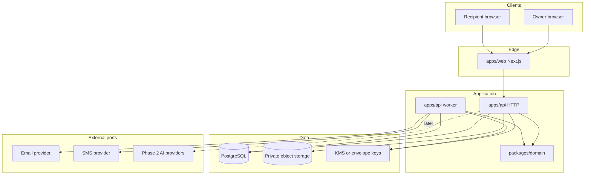

# 03 — Technical architecture

Status: proposed, 2026-11-03. The repository had no stack. This is a recommendation for an empty project, not a description of existing code.

## Audit result

No framework, language, dependency manifest, database, auth system, storage layer, deployment config, tests, or prior docs were present. Architecture is chosen for a small team, high-trust data, and a later AI phase that must not force a rewrite.

## Recommendation

Build a **modular monolith** in TypeScript.

| Layer | Choice | Why |
| --- | --- | --- |
| Web | Next.js and React.js (TypeScript, App Router) | Frontend: owner UI and recipient portal in one app, phone-friendly |
| API | Fastify | Backend. Module boundaries match the domains below. A long-lived process fits uploads metadata, audit, and workers better than scattering rules across serverless functions |
| Worker | Second entrypoint in `apps/api` | Same domain services, separate process. Avoids a second copy of release rules |
| Domain rules | `packages/domain` with no I/O | Check-in and verification state machines stay unit-testable |
| Database | PostgreSQL | Foreign keys, unique idempotency keys, transactions around "authorize then enqueue" |
| ORM / migrations | Prisma in `packages/db` | Schema is reviewable. Drizzle is an acceptable alternative if the implementer prefers SQL-first migrations |
| Jobs | pg-boss (Postgres-backed) | Release and reminder jobs commit with the rows they depend on. One less service than Redis at MVP volume. Revisit BullMQ + Redis only if job latency or volume demands it |
| Object storage | S3-compatible private bucket (AWS S3, Cloudflare R2, or Backblaze B2) | Presigned upload and download. Pick the vendor with the right region and egress after decision D-1. Do not store bytes on the app server |
| Auth | Self-hosted session auth. Preferred library: Better Auth, with Auth.js as an alternative | Identity data stays in PostgreSQL. Clerk or similar is faster to wire and is acceptable only if residency and a vendor exit plan are accepted in D-3 |
| Passwords | Argon2id | Memory-hard. Bcrypt is a fallback |
| MFA | TOTP | Recovery codes hashed at rest |
| Validation | Zod at API boundaries | Share types with the web app where practical |
| Email | Provider behind `NotificationPort` | Resend, Postmark, or SES are candidates. Dev implementation logs to the console. Do not send real email as part of roadmap work |
| SMS | Same port, off by default | Twilio or a local carrier aggregator after D-1 |
| Secrets | Host secret manager or locked environment variables | Never commit `.env` |
| Logs | Structured JSON (pino) | Redact emails, tokens, and message bodies |
| Errors | Sentry or equivalent, scrubbed | Optional at first deploy; required before public launch |
| Monorepo | pnpm workspaces | npm workspaces are acceptable |

### Why this and not a pile of microservices

Verification, check-in, and release must share one transaction boundary. Splitting them across services adds failure modes (dual writes, partial release) before there is a team to operate them. Modules can be extracted later if a boundary earns its own deployable.

### Why the web app is not the only backend

A calendar reminder can wait. A release job must retry for hours, record attempts, and stay idempotent. Serverless function timeouts and split cron invocations are a poor home for that state machine. Next.js should call the API. It should not own release rules inside ad hoc server actions.

### Mobile

MVP is a responsive website. Recipients open links on phones. A PWA install prompt is optional polish. Native iOS and Android apps are Phase 3 unless upload testing shows mobile browsers cannot reliably send the chosen video size. Then add chunked uploads before building native apps.

### API style

JSON over HTTPS, versioned `/v1`. Resource-oriented routes. OpenAPI generated from the Fastify routes once the first module exists. GraphQL is unnecessary for these screens.

## Logical architecture

The dotted AI path does not exist in Phase 1. No avatar SDK belongs in the Milestone 1 dependency install.

## Modules

All paths are relative to the future `apps/api/src/modules/` tree.

| Module | Responsibility | Depends on |
| --- | --- | --- |
| `identity` | Register, session, MFA, recovery, profile | audit |
| `capsules` | Capsules, items, tags, draft/schedule/release states | identity, media, audit |
| `media` | Presign, checksum, complete-upload, download authorization | identity |
| `people` | Recipients, trusted contacts, verification of contact channels, grants | identity, audit |
| `schedules` | Time zone rules, embargo, next occurrence | capsules, people, domain |
| `liveness` | Check-in policy and events | identity, notifications, domain |
| `verification` | Cases, attestations, disputes, cooling-off | people, liveness, domain, audit |
| `releases` | Jobs, idempotency, commit, retry | schedules, verification, media, notifications |
| `notifications` | Templates, consent flags, provider port, delivery log | people |
| `consent` | Policy versions, grants, revocations | identity, audit |
| `audit` | Append-only audit events | — |
| `avatar` | Empty module slot for Phase 2 | consent, capsules, media |

`packages/domain` exports:

- `checkInReducer(state, event) -> state`
- `verificationReducer(state, event) -> state`
- `nextOccurrence(rule, fromInstant, timeZone) -> instant`
- `canView(principal, item, grants) -> boolean`

Reducers are pure. The Fastify services load a row, apply the reducer, and write the new state plus an outbox job in one database transaction. Illegal transitions throw. There is no "force release" admin function in the domain model.

## Key flows

### Upload

1. Browser asks `POST /v1/media/uploads` with mime type and byte size.
2. API checks quota and returns a presigned PUT to a private bucket prefix scoped to the author.
3. Browser uploads directly to storage.
4. Browser calls `POST /v1/media/uploads/{id}/complete`.
5. API reads checksum and length from storage, stores them, and marks the asset `ready`.
6. An item references the asset only after `ready`.

Downloads use a short-lived signed GET issued only after `canView` passes. URLs are not stored as permanent access.

### Scheduled release

1. Worker polls due schedule occurrences.
2. For a calendar trigger, authorization is the schedule itself plus active grants. No liveness check is required to deliver a birthday message the author configured to send while alive.
3. Insert `release_jobs` with a unique idempotency key. Conflict means the job already exists.
4. Send a notification with a portal link, not the file.
5. Mark the job sent only after the provider accepts it. Retry with backoff. After N failures, dead-letter and alert. Never create a second logical delivery.

### Death-related release

The worker must not enqueue a content delivery from a check-in timer. It may enqueue unreachable notices. Content jobs are created only when a verification case enters `release_authorized` and the final cancellation window has elapsed. See [05_liveness_and_release_workflow.md](05_liveness_and_release_workflow.md).

## Encryption placement

**Recommendation (decision D-2):** platform-managed envelope encryption.

- Object storage uses SSE with a key the platform controls (SSE-S3 or SSE-KMS).
- Letter bodies are encrypted in the application with a data key, wrapped by KMS, before they are written to PostgreSQL.
- The application can decrypt when an authorized recipient loads an item or when an export is built. That is required for unattended delivery after the author is gone.
- A zero-knowledge design, where only the author's password unwraps content, conflicts with delivery when the author cannot authenticate. Offer it only as a future mode that disables server-side release, or pair it with explicit key escrow to a trusted contact. Do not silently claim both zero-knowledge and automatic posthumous delivery.

Every decrypt is an audit event: actor, item id, purpose (`preview`, `recipient_view`, `export`). Message body never enters logs.

Encryption context on wrapped keys should include `owner_user_id` and `item_id` so a key cannot be unwrapped for a different row by mixing ciphertext.

## Authentication and recovery

- HTTP-only, Secure, SameSite session cookies between web and API. If they are on sibling sites, configure the cookie domain explicitly and CSRF-protect cookie sessions.
- Access sessions are short. Refresh rotates.
- Password reset tokens are single-use and hashed at rest.
- MFA recovery codes are single-use.
- Optional email magic link is for **check-in confirmation** and **recipient invite acceptance**, not a standing login bypass around MFA. If the author enabled MFA, a check-in link may confirm liveness only when tied to a previously verified channel, and it must not disable MFA or change recipients. Exact binding is specified in the liveness doc.
- Account recovery by support is a manual, audited process. Support cannot complete it by reading the capsule.

## Notifications

`NotificationPort` methods:

- `sendEmail({ to, templateId, variables, idempotencyKey })`
- `sendSms({ to, templateId, variables, idempotencyKey })` — no-op provider until SMS is enabled

Templates are code or reviewed files, not raw HTML from users. Variables are escaped. Delivery rows store provider message id and status (`queued`, `sent`, `failed`, `bounced`). Webhooks update status. A bounce on the author's only email raises an in-app warning and can notify a trusted contact that the channel is broken. A bounce is not a death signal.

## Phase 2 seam

The `avatar` module may call providers. It may read items the consent record allows. It must not write new capsule items that look like original letters. Generated artifacts, if stored, use a separate table and a synthetic flag. Deleting consent calls provider deletion and removes local embeddings. Provider choice stays outside Phase 1 schema migrations except for nullable tables added when Phase 2 starts.

## Observability

- Correlation id per HTTP request and per job.
- Metrics: check-ins due, check-ins confirmed, jobs failed, verification cases by state, upload errors, decrypt count.
- Alerts: job dead-letter, backup failure, error spike, any release job created from a case that is not `release_authorized`.
- Tracing can wait until the first production deploy is stable. Logs plus a few metrics are enough for beta.

## Scalability

**Assumption:** private beta is hundreds to a few thousand authors, not a consumer social scale. PostgreSQL, one API, one worker, and one bucket are enough. Scale path when measured:

1. Read replicas for the portal.
2. More worker concurrency, still one queue.
3. Redis/BullMQ if pg-boss becomes the bottleneck.
4. Separate media processing (transcode) if video playback requires it. Store originals first; transcoding is not an MVP requirement if the browser can play the uploaded type.

## Deployment shape

One region, chosen with D-1. Containers for `web`, `api`, and `worker`. Managed PostgreSQL. Managed object storage. Infrastructure as code when the host is chosen (Terraform, Pulumi, or the host's native config). Details in [10_deployment_and_operations.md](10_deployment_and_operations.md).

## Suggested first dependencies

Do not install them until Milestone 1 starts.

Frontend: `next`, `react`, `typescript`, a maintained React UI approach (plain CSS or Tailwind — pick at implementation; Tailwind is the default suggestion).

Backend: `fastify`, `prisma`, `@prisma/client`, `zod`, `argon2`, `pg-boss`, `@aws-sdk/client-s3`, `@aws-sdk/s3-request-presigner`, `pino`.

Tests: `vitest` for domain and services, `supertest` for HTTP, Testcontainers or a CI Postgres service for integration, Playwright for a short list of browser journeys.

Auth library: add Better Auth or the chosen alternative in the identity milestone, not before the decision D-3 note is updated.

## Explicit non-choices for the MVP

- Microservices, Kubernetes as a requirement, GraphQL, blockchain anchoring, homomorphic encryption, client-side-only encryption that blocks delivery, in-house voice models, and a custom video codec pipeline.
