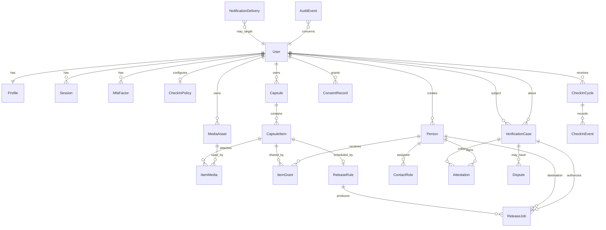

# 04 — Database schema

Status: proposed, 2026-11-03. This is the logical model for Prisma in `packages/db/prisma/schema.prisma`. It is not migrated yet. Physical column types can be adjusted at implementation as long as the constraints stay.

All timestamps are `timestamptz` in UTC. Schedules also store an IANA time zone name and local civil time. Primary keys are UUIDs. Soft-delete (`deleted_at`) is used where recovery matters; legal deletion must still hard-delete ciphertext and objects. See retention in [07_security_privacy_and_compliance.md](07_security_privacy_and_compliance.md).

## Ownership rules

| Data | Owner | Who else may read |
| --- | --- | --- |
| User credentials, MFA secrets | The user | Nobody via the product UI. Hashed secrets are not recoverable |
| Profile | The user | Nobody else |
| Capsule and unreleased items | The author user | Nobody, including trusted contacts and staff, through the application |
| Media objects | The author user | A principal who passes `canView` for a referencing item |
| Recipient / contact book | The author who created the row | The contact sees their own invite and, later, their grants |
| Released item | The author remains the data controller | Recipients named on an active grant for that item, after release |
| Check-in and audit rows | The author | The author in a readable activity view. Operators see metadata only if a break-glass process exists |
| Verification attestation | The contact who signed it, about the author's case | Author (if they return), contacts on that case, audited reviewers |
| Avatar models (Phase 2) | The author | Principals listed on a future avatar grant, only while consent is active |

There is no organization tenant in the MVP. `owner_user_id` is the tenancy boundary. Every query is scoped by it, then by grants. Do not trust a client-supplied owner id; take it from the session.

## Relationship diagram

`Person` is the author's address-book row for a recipient or trusted contact. It may later link to a `User` when that human claims a login (`Person.linked_user_id`).

## Tables

### Identity

**users**

| Column | Notes |
| --- | --- |
| id | PK |
| email | Unique, normalized lowercase |
| email_verified_at | Null until verified |
| phone_e164 | Nullable, unique when present |
| phone_verified_at | Nullable |
| password_hash | Argon2id |
| status | `active`, `pending_deletion`, `deleted` |
| deletion_requested_at | Nullable |
| created_at, updated_at | |

**profiles**

| Column | Notes |
| --- | --- |
| user_id | PK and FK |
| display_name | Required |
| time_zone | IANA name, required |
| locale | BCP 47, default `en` |
| check_in_channel_email | Boolean, default true |
| check_in_channel_sms | Boolean, default false, requires phone consent |

Do not require legal name or government id in the MVP schema.

**sessions** — id, user_id, token_hash, created_at, expires_at, revoked_at, user_agent, ip subnet or coarse geo only if a security review allows it. Prefer not storing full IP forever.

**mfa_factors** — id, user_id, kind (`totp`), secret_ciphertext, confirmed_at, disabled_at.

**recovery_codes** — id, user_id, code_hash, used_at.

**password_reset_tokens** — id, user_id, token_hash, expires_at, used_at.

### People and permissions

**persons**

| Column | Notes |
| --- | --- |
| id | PK |
| owner_user_id | FK users. The author |
| linked_user_id | Nullable FK users. Set when they claim a portal |
| display_name | |
| email | Nullable until invited |
| phone_e164 | Nullable |
| relationship | Free text plus optional enum: partner, child, parent, sibling, friend, other |
| birth_date | Nullable date. Needed for age-based rules. Sensitive |
| time_zone | Nullable. Falls back to author time zone |
| is_minor | Nullable boolean, author-asserted. Not an identity proof |
| created_at | |

**contact_roles**

| Column | Notes |
| --- | --- |
| id | PK |
| person_id | FK |
| role | `recipient`, `trusted_contact`, `verifier` |
| capsule_id | Nullable. Null means account-level trusted contact or verifier. Recipient grants are per item, not implied by this row |
| channel_verified_at | Nullable |
| created_at, revoked_at | |

A person may hold several roles. `verifier` implies they may open or attest a case. It does not imply `recipient`.

**item_grants**

| Column | Notes |
| --- | --- |
| id | PK |
| capsule_item_id | FK |
| person_id | FK, must belong to the same owner |
| visibility | `hidden`, `released_only` |
| created_at, revoked_at | |

Unique `(capsule_item_id, person_id)` where `revoked_at` is null. No grant means no access. `hidden` means the person must not see the item even after a capsule-level event (explicit exclusion).

### Capsules and media

**capsules**

| Column | Notes |
| --- | --- |
| id, owner_user_id | |
| title, description | Description may be ciphertext later; MVP can start with encrypted body only on items |
| status | `draft`, `active`, `paused`, `archived` |
| created_at, updated_at, archived_at | |

Pausing a capsule stops future release jobs. It does not delete items.

**capsule_items**

| Column | Notes |
| --- | --- |
| id, capsule_id | |
| kind | `letter`, `photo`, `video`, `audio`, `document`, `collection` |
| title | May be shown only after release. Treat as private |
| body_ciphertext | Nullable. Letters and captions |
| body_nonce, dek_wrapped, kms_key_id | Nullable until envelope encryption is wired. Do not store plaintext letters in production |
| memory_on | Nullable date the memory is about |
| category | Nullable short label |
| status | `draft`, `scheduled`, `released`, `withheld`, `cancelled` |
| released_at | Nullable. Set when the first successful recipient delivery for this item commits, or when the item becomes visible in the portal, whichever the release service defines. Use job rows for per-recipient truth |
| created_at, updated_at | |

**tags** and **item_tags** — id, owner_user_id, name; item_id, tag_id. Tags are private to the author.

**media_assets**

| Column | Notes |
| --- | --- |
| id, owner_user_id | |
| storage_key | Bucket key, not a public URL |
| mime_type, byte_size | |
| sha256 | Set at complete |
| status | `pending`, `ready`, `failed`, `deleted` |
| created_at, deleted_at | |

**item_media** — item_id, media_asset_id, caption_ciphertext nullable, position. Unique pair.

### Schedules and jobs

**release_rules**

| Column | Notes |
| --- | --- |
| id, capsule_item_id | One active rule per item in the MVP. Unique where cancelled_at is null |
| trigger | `exact_time`, `annual`, `recipient_age`, `embargo_until_age`, `embargo_until_time`, `after_verification` |
| time_zone | IANA |
| local_date | Nullable date |
| local_time | Time of day |
| person_id | Nullable. The recipient whose birth date or age is the clock |
| age_years | Nullable |
| embargo_until | Nullable timestamptz computed and stored for indexing, recomputed if inputs change |
| next_run_at | Nullable timestamptz, indexed |
| status | `active`, `paused`, `completed`, `cancelled` |
| created_at, cancelled_at | |

`after_verification` leaves `next_run_at` null. Jobs are created by the verification service, not the calendar scanner.

Annual rules store month and day. Implementers must define 29 February behavior (**assumption:** run on 28 February in non-leap years, documented in the UI).

**release_jobs**

| Column | Notes |
| --- | --- |
| id | |
| idempotency_key | Unique. Suggested composition: `{item_id}:{person_id}:{occurrence_iso}` or `{case_id}:{item_id}:{person_id}` for verification releases |
| release_rule_id | Nullable for manual replay of the same key only |
| verification_case_id | Nullable. Required when trigger is after verification |
| capsule_item_id, person_id | |
| occurrence_at | The scheduled instant |
| status | `pending`, `sending`, `sent`, `failed`, `cancelled`, `dead` |
| attempt_count | |
| provider_message_id | Nullable |
| created_at, sent_at, cancelled_at | |

Partial unique index on the idempotency key. A replay of a failed job updates the same row. It does not insert another.

### Liveness

**check_in_policies**

| Column | Notes |
| --- | --- |
| user_id | PK |
| interval_days | Default 30. Minimum and maximum set in product config (suggested 14 to 180, **assumption**) |
| paused_until | Nullable |
| next_due_at | |
| reminder_plan | JSON array of day offsets after due time. Default documented in the liveness doc |
| unreachable_after_days | When trusted contacts are notified. Not a death transition |
| updated_at | |

**check_in_cycles** — one row per due period.

| Column | Notes |
| --- | --- |
| id, user_id, due_at | |
| state | `due`, `reminded`, `confirmed`, `missed_unreachable`, `cancelled` |
| confirmed_at, confirmation_method | `session`, `email_link` |
| created_at | |

Unique `(user_id, due_at)`.

**check_in_events** — append-only: cycle_id, type (`notice_sent`, `reminder_sent`, `confirmed`, `link_expired`, `paused`), at, notification_id nullable.

### Verification

**verification_cases**

| Column | Notes |
| --- | --- |
| id, subject_user_id | |
| state | See state list in the liveness doc |
| opened_by_person_id | The verifier who explicitly opened it |
| quorum_required, quorum_of | Integers copied from policy at open time so later setting changes do not rewrite history |
| cooling_off_ends_at | Nullable |
| cancellation_window_ends_at | Nullable |
| resolution | Nullable: `recovered`, `disputed_blocked`, `authorized`, `cancelled` |
| opened_at, resolved_at | |

Only one non-terminal case per subject. Enforce with a partial unique index.

**attestations**

| Column | Notes |
| --- | --- |
| id, case_id, person_id | Unique pair |
| position | `believe_deceased`, `reached_alive`, `unknown`, `dispute` |
| note | Short text, not a place to paste capsule content |
| attested_at | |
| withdrawn_at | Nullable |

**case_documents** — optional later: id, case_id, media_asset_id, uploaded_by_person_id, purpose (`death_certificate` or `other`). Uploading a file does not change state by itself. There is no automatic document acceptance.

**disputes** — id, case_id, opened_by (`author` or person_id), reason, opened_at, resolved_at, outcome.

### Notifications, consent, audit

**notification_deliveries**

| Column | Notes |
| --- | --- |
| id, idempotency_key | Unique |
| channel | `email`, `sms` |
| template_id | |
| destination_hash | Or encrypted destination. Avoid putting raw addresses in wide log exports if a separate encrypted column exists |
| status | `queued`, `sent`, `failed`, `bounced` |
| related_type, related_id | cycle, job, case |
| provider_message_id, error_code | |
| created_at, updated_at | |

**consent_records** — id, user_id, purpose (`terms`, `privacy`, `sms_check_in`, `voice_replica`, `likeness_replica`, `avatar_posthumous_use`), policy_version, granted_at, revoked_at, source (`signup`, `settings`).

Phase 1 uses terms, privacy, and optional SMS. Voice and likeness rows are unused until Phase 2, but the table should exist before any avatar work so consent is not bolted on as a boolean column.

**audit_events** — append-only.

| Column | Notes |
| --- | --- |
| id, actor_user_id | Nullable for system worker |
| actor_person_id | Nullable |
| action | Stable string, e.g. `item.grant_created`, `case.state_changed`, `media.decrypt` |
| entity_type, entity_id | |
| metadata | JSON. No bodies, tokens, or signed URLs |
| at | |

No update or delete API for audit rows. Database permissions for the app role should revoke UPDATE and DELETE on `audit_events` if operations can support it. If not, the service simply never issues those statements, and a test fails when it tries.

## Access checks

Implement `canView` only in `packages/domain` and call it from media download, portal queries, and exports.

A recipient user can view an item when all are true:

1. Their user id matches `persons.linked_user_id`.
2. An `item_grants` row exists for that person and item, not revoked, visibility `released_only`.
3. Item status is `released`.
4. A `release_jobs` row for that person and item is `sent`, or the item was released to them by a committed job. Drafts never qualify.
5. The capsule is not in a state that withholds already unsent jobs. Already sent items stay visible unless the author deletes the account or a legal hold process removes them. **Assumption:** authors cannot silently unsend a delivered letter; they may delete the account going forward. Confirm as Q-8.

Trusted contacts and verifiers fail `canView` unless they also have a recipient grant and the item is released to them.

The author can view their own items in any status.

Anonymous callers fail.

Staff fail unless a break-glass grant exists. No such table in the MVP. Do not add a hidden admin read.

## Deletion

Account deletion:

1. Mark `pending_deletion`.
2. Cancel pending jobs and check-ins.
3. After the cooling period, delete objects, wrapped keys, letter ciphertext, embeddings (future), and personal identifiers.
4. Retain a minimal audit skeleton if counsel requires a record that deletion occurred: user id hash, timestamp, action `account.deleted`. No message content.

Deleting one item deletes its object if no other item references that asset, and cancels pending jobs.

## Phase 2 tables (do not migrate in Milestone 1)

Add later, in an avatar migration:

- **avatar_profiles** — user_id, status, synthetic_label_required (always true), created_at.
- **replica_assets** — kind `voice` or `face`, provider, provider_subject_id, consent_record_id, status.
- **knowledge_sources** — item ids explicitly included. Default empty, opt-in per item.
- **restricted_topics** — user_id, phrase or category.
- **avatar_sessions** — recipient user, profile, started_at. Transcripts are sensitive; default to not storing full transcripts. **Open question Q-11.**

## Indexing notes

- `release_rules(next_run_at)` where status = `active`.
- `release_jobs(status, occurrence_at)`.
- `check_in_policies(next_due_at)`.
- `verification_cases(subject_user_id)` partial unique for open states.
- `media_assets(owner_user_id, status)`.
- `persons(owner_user_id)`.
- `item_grants(person_id)`.

## Data that must not be stored

Government id numbers, payment card data (use a payment provider's token if billing is added), raw TOTP secrets in plaintext, permanent public URLs, and copies of recipient messages inside notification provider payloads beyond what the template needs. Email templates should say "a memory is ready" and link to the portal, not quote the letter.
