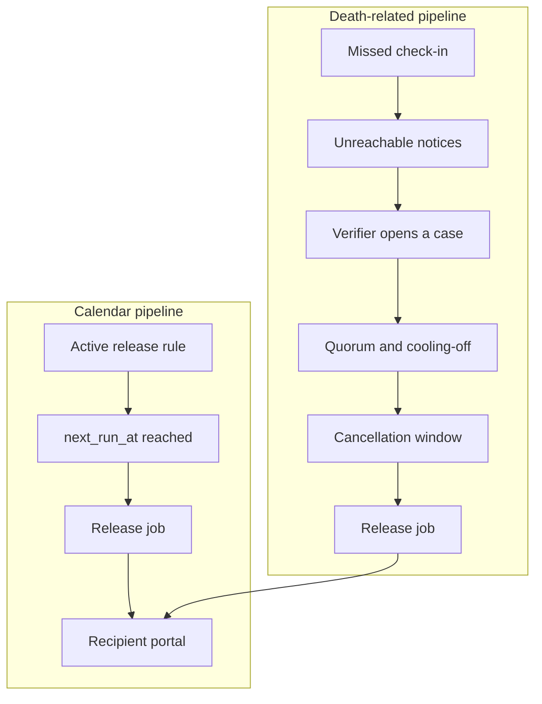
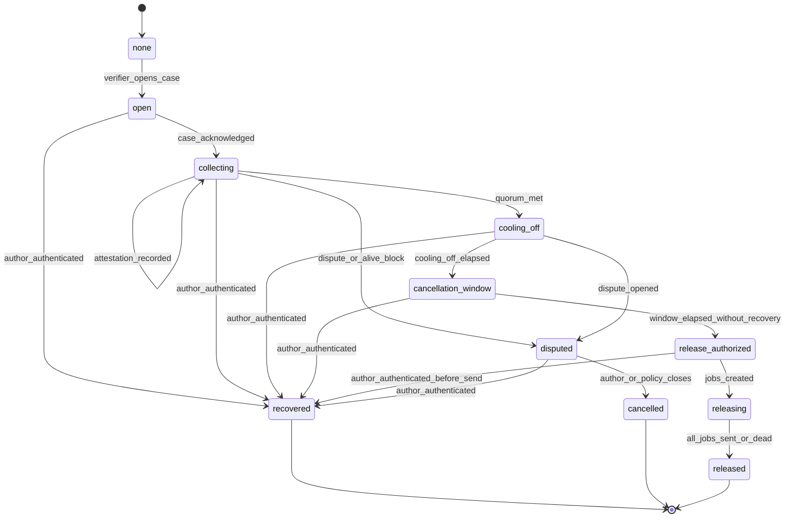

# 05 — Liveness and release workflow

Status: proposed, 2026-11-03. Defaults below are **product proposals**, not legal standards. Counsel must review them before the verification feature flag is enabled for real users (decision D-1 and milestone 5).

## Safety invariants

These are testable and must not be relaxed by configuration:

1. No code path creates a content `release_job` solely because a check-in is overdue.
2. A calendar or age rule can release while the author is alive, because they scheduled that delivery. That path does not consult the check-in state.
3. A death-related content job is created only from a verification case in `release_authorized` after the cancellation window, and only for items whose rule is `after_verification` (or an embargo that explicitly requires verification — do not add that combination unless a story says so).
4. If the author authenticates successfully before a death-related job is `sent`, the case resolves `recovered` and pending death-related jobs become `cancelled`.
5. Any `dispute` attestation or author dispute moves the case to `disputed` and blocks release.
6. Trusted contacts never receive capsule contents as part of this workflow.
7. Copy in notices describes unreachability, review, and cancellation. It does not say the system has determined that the person died.

The system cannot prove death. Each method below has false positives. A false positive that commits delivery can expose private letters and cannot always be unseen. Design for slow authorization.

## Two pipelines

The timer never has an arrow to `djob`.

## Check-in policy

Proposed defaults, all editable per author within config bounds:

| Setting | Default | Purpose |
| --- | --- | --- |
| Interval | 30 days | How often the author confirms they can still access the account |
| Grace before reminders | 0; first message is the due notice | The due notice is not an accusation |
| Reminder offsets after due time | 3, 7, 14, 21 days | Configurable series |
| Unreachable notice to trusted contacts | 21 days after due | Welfare check |
| Channels | Email on, SMS off | SMS only with `sms_check_in` consent and a verified phone |
| Pause | Author-set `paused_until` | No reminders during pause. Pause cannot be longer than a configured cap without reconfirmation (**assumption:** 180 days, then the author must extend it) |

Suggested bounds: interval 14–180 days. If the author sets a long interval, the UI states that a long silence delays welfare notices.

### Confirming liveness

Either method is enough:

1. **Session.** Signed-in author chooses "I'm here" on the home banner. MFA still applies if they are logging in fresh.
2. **Email link.** Single-use token, hashed at rest, expires in 48 hours (**assumption**), bound to `check_in_cycles.id`. It posts a confirmation and shows a page that says the check-in was recorded. It does not create a full session that can change grants or payment methods. If the product later allows the link to start a limited session, that session cannot edit recipients, rules, or verifiers.

A confirmation writes `check_in_cycles.state = confirmed`, appends an event, and computes the next `next_due_at` from the confirmation time plus the interval. It closes any open verification case via the `author_recovered` event if the case is not already `releasing` with sent jobs.

Missed confirmation does nothing to item status.

### Reminder escalation

For each offset, the worker sends at most one reminder per cycle per channel (idempotency key `cycle:{id}:reminder:{offset}:{channel}`). Failures retry. A failed send stays in the delivery log and does not skip the next offset. If all channels fail, alert operators and, if a verified trusted contact exists, send a plain "we could not deliver reminders to the author" notice. That notice is still not a death determination.

Author pause or confirmation cancels the remaining offsets for that cycle.

### Author activity history

The author can see: due time, notices sent, delivery status, confirmation time and method, pauses, and case state changes. They do not need to see provider internals.

## Verification state machine

`none` means no open case. It is not a row.

### How a case starts

A verifier (a person with role `verifier`, channel verified) deliberately submits "Request a release review." The form requires them to state that they are asking for a review, not confirming a medical or legal fact. The system records `opened_by_person_id`.

The unreachable notice may include that button. Opening still requires the human action. There is no scheduled transition from `missed_unreachable` to `open`.

**Optional stricter policy (decision D-7):** require two verifiers to request opening before `open` exists. The proposed default is one verified verifier may open, and quorum applies before cooling-off.

### Attestations

Positions:

| Position | Effect |
| --- | --- |
| `believe_deceased` | Counts toward quorum. Label in UI: "I believe a release review should continue." It is an attestation, not a certificate |
| `reached_alive` | Immediately `disputed` / blocks, and notifies the author on all channels. Does not delete the case history |
| `unknown` | Recorded, does not count |
| `dispute` | Blocks |

Proposed default quorum: **2 attestations of `believe_deceased` out of the author's verifiers, with a minimum of 2 verifiers on the account before death-related release can be armed.** If the author named only one verifier, the UI says death-related release cannot complete until they name another, or until they accept a slower manual-review policy.

### Manual review and documents

**Assumption for beta:** Digi Capsule staff do not decide death. There is no operations queue that approves release.

A later option, off by default: the author requires an uploaded document plus quorum. A human reviewer marks "document received and legible" without the software claiming the document is authentic. Forged documents are a known limit. Manual review reduces some errors and adds insider risk, delay, and a duty to secure the file. Do not OCR identity documents into the letter database.

If the launch market expects a death certificate, counsel should say whether the product should ask for one, who may see it, how long it is kept, and whether storing it creates new legal duties. Until that opinion exists, do not collect certificates in production.

### Cooling-off and cancellation window

Proposed defaults:

| Window | Default | What happens |
| --- | --- | --- |
| Cooling-off after quorum | 14 days | Author and all verifiers are notified every few days that a review is in the last waiting period and how to stop it |
| Final cancellation window | 72 hours | No content jobs are inserted until this ends. Notices say the date and time in the author's time zone |

Either number must be configurable per author at case-open time and then frozen on the case row.

During both windows the author can sign in and recover. A verifier can file `dispute` or `reached_alive`. Either stops the clock permanently until a new case is opened later. **Assumption:** a new case cannot be opened for 7 days after recovery, to reduce harassment loops. Configurable.

### Release authorization

When the cancellation window elapses, the reducer moves to `release_authorized`. The worker then:

1. Re-reads the case. If it is not exactly `release_authorized`, stop.
2. Selects items with an active `after_verification` rule and active recipient grants.
3. Inserts jobs with idempotency keys. A second worker pass inserts nothing new.
4. Moves the case to `releasing`.
5. Sends portal notifications.
6. Marks jobs `sent` only after provider acceptance.
7. If the author authenticates mid-flight, cancel jobs still not `sent`. Jobs already `sent` cannot be unsent. The case records `recovered_partial` in metadata if some sends completed. This race is why the window exists and why sends happen only after it.

Dead-lettered jobs do not flip the item to released for that recipient. Operators can replay the same idempotency key after fixing the provider. Replay is not a new occurrence.

### Disputes

Who may dispute:

- The author, always, by any successful authentication before send.
- Any trusted contact or verifier on the account.
- A recipient, only about their own pending delivery, during the cancellation window. They can ask to pause, which blocks and notifies verifiers. They cannot approve release.

Dispute UI copy: "Stop this review." It does not ask the family to litigate inside the product. A blocked case stays blocked until the author recovers or, if the author never returns, the verifiers must open a new case after the cooldown and meet quorum again. There is no staff override button in the MVP.

### False-alarm recovery

| Situation | Intended behavior |
| --- | --- |
| Author was traveling, sees reminders | One confirmation resets the interval. No case exists |
| Author lost email access | They use password reset on a new email only after proving control of the old session or a verified recovery method. Changing email is audited and notifies trusted contacts. **It must not be enough, by itself, to authorize release** |
| Trusted contact was notified in error | They choose "I reached them" or ignore it. Ignoring a welfare notice does not open a case |
| Case opened in error | Author signs in, or any verifier disputes. Pending jobs cancel |
| Some emails already went out | Portal access for unsent recipients is not created. Sent notices may have been seen. Support playbook apologizes and explains what was and was not delivered. This is a serious incident |
| Malicious verifier | Quorum, second verifier, cooling-off, and author recovery limit damage. The author can revoke a verifier, which withdraws their attestations and re-checks quorum |

## Calendar release rules

The schedule scanner runs at least every minute in the worker.

| Trigger | Behavior |
| --- | --- |
| `exact_time` | One job per granted recipient at the zoned instant |
| `annual` | Next occurrence via IANA time zone rules, including DST gaps and overlaps. If a local time is skipped, run at the next valid instant. If it repeats, run once on the first offset |
| `recipient_age` | On the recipient's birthday in their time zone (or the author's if missing) when they reach `age_years`. One shot |
| `embargo_until_age` or `embargo_until_time` | Item stays `scheduled`. At the embargo instant, create jobs. Use this for the series of childhood letters released together on an eighteenth birthday |
| `after_verification` | Ignored by the calendar scanner |

Reschedule updates `next_run_at` and cancels `pending` jobs for occurrences that have not been sent. It cannot claw back `sent` jobs.

Preview builds the recipient view from drafts without writing jobs or notifications.

## Recipient delivery

1. Job moves to `sending`.
2. Email (or SMS if consented) says who the capsule is from, that an item is available, and links to the portal. It does not include the letter text or a raw storage URL.
3. Recipient signs in or accepts an invite.
4. Portal query returns items where `canView` is true.
5. Media route returns a signed URL with a short TTL (**assumption:** 5 minutes) after `canView` again.

If the recipient has no account yet, the invite token lets them set a password and links `persons.linked_user_id`. The token does not expose other people on the author's list.

## What operators may do

- Replay a dead job by id.
- See job status, template id, and hashed destination.
- They may not open letter ciphertext or buckets from the admin path, because there is no admin path in the MVP.

If production support later needs break-glass, that is a new design: two people, time-limited, ticket id, customer notice, full audit. It is out of scope until written up and accepted.

## Limits of verification methods

| Method | What it can show | What it cannot show | False positive consequence |
| --- | --- | --- | --- |
| Missed check-in | Messages were not confirmed | Death, incapacity, or lost phone | If misused as a trigger, private media goes to the wrong people while the author is alive |
| Single trusted contact | That person made a statement | Truth of the statement, or freedom from coercion | Wrongful or abusive release |
| Quorum of contacts | Several people made the same request | Legal fact of death | Family conflict, fraud, or shared mistake |
| Cooling-off | Time for the author to object | That the author saw the notice | Author unreachable for ordinary reasons still loses the race if they return late |
| Uploaded certificate | A file was uploaded | Authenticity | Forgery, wrong person, or stolen scan |
| Staff review | A person looked at a file | Infallible judgment | Insider misuse and delay |
| Court or civil registry, if ever integrated | Depends on the registry's own reliability | Worldwide coverage | Wrong record match |

No combination removes the last row's risk. The product policy is to prefer delay and non-release over speed.

## Feature flag

`VERIFICATION_RELEASES_ENABLED=false` in every environment until milestone 5 acceptance tests pass and the decision log says counsel review is done. Calendar releases can ship with the flag off.
