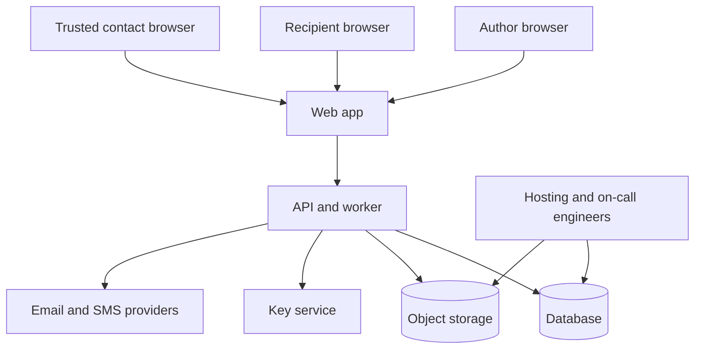

# 07 — Security, privacy, and compliance

Status: proposed, 2026-11-03. This is an engineering threat model and a list of counsel questions. It is not a legal opinion, a certification, or a claim of compliance.

## Security objectives

- Authors' unreleased memories stay confidential.
- Only intended recipients receive released items.
- A timer, a stolen inbox alone, or a single malicious contact cannot complete death-related release.
- Operators and hosting staff do not have a normal way to browse content.
- Tampering with audit history is detectable by process, and preferably prevented by database grants.
- The service can restore from backup and can delete on request.

## Trust boundaries

Providers and engineers are inside the threat model. "The vendor is reputable" is not a control.

## Threat model

| ID | Threat | Impact | Controls |
| --- | --- | --- | --- |
| T-1 | Credential stuffing or phishing of the author | Account takeover, change of recipients, theft of drafts | MFA, breached-password check if a privacy-preserving API is chosen, session revocation on reset, notice to trusted contacts on recipient or email changes |
| T-2 | Stolen check-in or invite link | False liveness confirmation or unwanted portal signup | Single-use, short expiry, check-in link cannot edit grants, bind invite to one person id |
| T-3 | IDOR on item or media ids | Another user reads a capsule | `canView` on every read and every signed URL. Integration tests for cross-user ids |
| T-4 | Public bucket or long-lived URL | Silent leakage via logs and referrers | Private bucket, block public ACLs in IaC, short TTL, no URL in email |
| T-5 | Timer treated as death | Wrongful release | Domain invariant and tests. Feature flag |
| T-6 | Malicious or coerced verifier | Abusive release attempt | Quorum, second verifier, cooling-off, dispute, author recovery, revoke verifier |
| T-7 | SIM swap | SMS intercept | SMS is not a recovery factor for passwords in the MVP. SMS is an optional reminder channel only |
| T-8 | Insider reads the database | Disclosure of letters | Envelope encryption for bodies, no admin browser, decrypt audited, limited production credentials |
| T-9 | Backup theft | Same as T-8, plus old data | Encrypted backups, access logging, same key policy |
| T-10 | Job double send | Duplicate grief-sensitive emails, confused portal | Unique idempotency key |
| T-11 | Malware in uploads | Compromise of viewers | Content-type checks, no in-browser execution of documents, download documents as attachments, size limits. Malware scanning is P2 if a scanner is available |
| T-12 | Provider account compromise (email) | Password resets and social engineering | MFA on the provider. Reset templates that cannot change verifiers without a session. Notify contacts on email change |
| T-13 | Grief-based social engineering of support | Support "releases the capsule" | No support release tool in MVP |
| T-14 | Phase 2 voice used for fraud | Impersonation outside the product | Author-only enrollment, labels, no public avatar link, deletion |
| T-15 | Denial of wallet via huge video | Cost and outage | Quotas, max size, rate limits |
| T-16 | Audit tampering | Hide a grant change | Append-only access, tests, restricted DB role |
| T-17 | Dependency or supply chain | RCE | Lockfile, review of auth and storage libraries, least-privilege deploy keys |
| T-18 | Wrong recipient email typo | Stranger receives a notice | Confirm address, verification link before any release, show the address clearly in the author's UI |

## Controls to build

### Transport and storage

- HTTPS only, HSTS once the domain is stable.
- PostgreSQL encryption at rest provided by the host, plus application envelope encryption for letter bodies and captions.
- Private object storage with server-side encryption.
- TLS to the database.

### Authentication

- Argon2id passwords, unique salts via the algorithm's encoded hash.
- Optional TOTP. **Recommendation:** require MFA before an author can arm `after_verification` rules or add a verifier. Ordinary drafts can exist without MFA so people are not blocked from writing, but the UI should keep asking.
- Recovery codes hashed, shown once.
- Session fixation and logout-all.
- Rate limits on login, reset, check-in confirmation, and case opening.

### Authorization

- Default deny grants.
- Recipient-level checks as specified in the schema doc.
- Server-side authorization even when the UI hides buttons.
- Signed download URLs minted per request, suggested TTL 5 minutes, bound to the object key. Do not use a URL as the only authorization forever.

### Release integrity

- Idempotent jobs.
- State reducer tests for every illegal edge, including timer to release.
- Feature flag default off.
- Notification copy reviewed as part of the security checklist, because wording can cause a family to treat a welfare ping as a death notice.

### Secrets

- `.env` gitignored.
- Production secrets in the host secret store.
- Separate credentials for app runtime, migrator, and human break-glass.
- KMS keys not exportable to developer laptops.
- Rotate provider API keys on staff departure.

### Application hygiene

- Parameterized queries through Prisma.
- CSRF defense for cookie sessions.
- Security headers: `Content-Security-Policy`, `X-Content-Type-Options`, frame denial for the portal.
- DOM escaping of letter text. Letters are untrusted HTML. Render as text.
- Dependency scanning in CI before public launch.
- No capsule content in error trackers. Add a scrubber test.

### Administrators and service providers

MVP has no content-reading admin. Engineers can still reach disks if hosting IAM is loose. Operational rules:

- Production data access is named-person, logged, and rare.
- Prefer synthetic fixtures.
- Vendor DPAs and a subprocessor list before real user data: host, database, object storage, email, error tracking, and later SMS and AI.
- A public status page is optional. A private incident contact is not.

### Consent and audit

- Record terms and privacy version at signup.
- Audit grant changes, verifier changes, email changes, case transitions, decrypts, exports, and deletions.
- Author-visible activity log for those events in plain language.

### Export, deletion, retention

| Data | Proposal to take to counsel |
| --- | --- |
| Active account | Kept while the account is open |
| Pending deletion | **Assumption:** 14-day cooling period, then hard delete |
| Backups | Expire on the backup cycle (**assumption:** 35 days) so deleted content disappears from restores. Document that restores can revive a deleted account only inside that window, and operators must delete it again |
| Audit skeleton | Minimal deletion proof. Duration is a legal question |
| Verification documents, if ever collected | Short retention, access limited, not in the marketing backup story |
| Server logs | **Assumption:** 30 days, scrubbed |
| Released items after the author's deletion | **Open question Q-8.** Proposal: deletion removes recipient access going forward and deletes objects. It cannot wipe a copy someone already downloaded |

Export format for MVP: a zip with original media, a JSON manifest of metadata, and letters decrypted to files the author downloads over HTTPS. Exports are another disclosure event; require recent authentication and MFA if enabled.

## Notification failure

- Retries with backoff.
- Dead-letter plus alert.
- Author sees failed check-in delivery in the activity log.
- Do not advance a verification case because a message failed.
- Do not mark a release job `sent` on a provider error.

## Backup tests

See operations doc. A milestone 6 gate is a restore drill on staging: recover the database and one object version, log in, and open an item. Untested backups are not a control.

## Privacy and legal questions for counsel

Do not invent answers in code comments. Record the opinion next to each question when it exists.

Launch markets are undecided (D-1). The questions change with the country. At minimum, ask about:

1. **Data-protection statute** for the launch country and for recipients who live elsewhere. If people in the EU, UK, or other regulated regions can sign up, assume their rules can apply and ask whether the beta must be geo-restricted.
2. **Lawful basis and notices** for authors, recipients, and trusted contacts who did not sign up themselves. Contact verification emails need a lawful basis and a way for the contact to refuse further mail.
3. **Special-category or biometric data** if Phase 2 processes voice or face. Some regions regulate biometrics specifically (for example Illinois BIPA is a known US state example; do not assume it is the only one). Confirm before any prototype uses real voices.
4. **Children.** Can a parent upload a child's photo? Can a minor be a recipient? What age gate applies if a teenager opens the portal? COPPA is relevant if US children are online users; other countries have their own ages. The product should not market to children as account holders.
5. **Posthumous data and contract survival.** Does the author's contract bind recipients? Who may demand deletion after death? Can an heir expand access? The product should not promise that family law will follow the in-app quorum.
6. **Wills and estate practice.** Digi Capsule must not be described as a will, a substitute for probate, or a transfer of property. Ask counsel for the disclaimer and whether any feature (executor tools) crosses into legal advice.
7. **Consumer-protection claims.** Forbidden implied claims: guaranteed delivery after death, certified proof of death, "your family will always be able to see this," indefinite storage.
8. **Publicity and impersonation law** for Phase 2 likeness, plus anti-fraud rules if a voice can be downloaded.
9. **Cross-border transfers** if the bucket, email vendor, or AI vendor is in another country.
10. **Breach notice** timelines for the launch country.
11. **Retention of death-related documents** if the product ever stores them.
12. **Tax and payments** if subscriptions start. Card data stays at the payment processor.

Also ask a security-minded reviewer, not only counsel, to read the state machine before the flag is enabled.

## Residual risk to state in the product

Even with quorum and delay, a person who is alive can be treated as unreachable, and a review can be started by people they trusted. The cancellation window reduces that risk and does not eliminate it. The public site and the in-app explanation should say this in plain language so families do not believe the software "knows."

## Security testing expectations

Listed as gates in [09_testing_and_acceptance_criteria.md](09_testing_and_acceptance_criteria.md). Minimum before beta: authorization tests, reducer tests, secret scanning in CI, dependency install from lockfile, and a checklist review of bucket policy.
